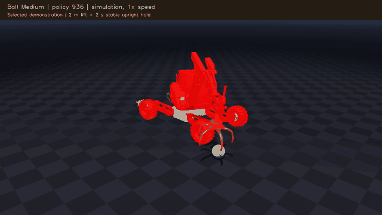

# Perceptive RL with an Excavator

**A video portfolio of simulation work on geometry-aware grapple manipulation.**

This project studies how a suspended excavator grapple can learn to pick up
objects with different shapes and sizes. The focus is object representation,
policy transfer, reward design, and diagnosing the behavior learned in contact.

[](media/ball_medium.webm)

*Selected medium-ball pickup, checkpoint 936. Click the image to open the video.*

## Demonstrations

| Example | Video | What it shows |
|---|---|---|
| Medium ball | [Watch](media/ball_medium.webm) | Approach, closure, lift and a stable hold |
| Large ball | [Watch](media/ball_large.webm) | Pickup of a larger-diameter object |
| Large Minion-shaped object | [Watch](media/minion_large.webm) | Handling an irregular shape with appendages |
| Long stick | [Watch](media/stick_large.webm) | Retention of an elongated object |

The animated README preview is downsampled to 10 fps. The full WebM clips are
continuous, selected successful simulation episodes, recorded at
20 fps and played at 1x simulation speed. They are illustrative examples, not
an unbiased measurement of success. Each shows the same frozen checkpoint.

For a local video gallery, clone or download this repository and run:

```bash
python3 -m http.server 8000
```

Then open **http://localhost:8000**. This runs only the video gallery, not a robot
controller or simulator. Videos can also be downloaded and played directly.

## Project highlights

- Represent object geometry with **20 farthest-point surface samples**.
- Encode that unordered point set with a **PointNet-style encoder**, alongside
  robot state, to produce arm and grapple commands.
- Transfer an existing rock-pickup policy into the new observation interface
  through **DAgger-style imitation**, initially using a medium ball.
- Fine-tune with **PPO across 36 object variants**: 12 shape families, each at
  three sizes.
- Investigate a learned strategy that braced the suspended grapple against its
  joint limits, then revise rewards and hold criteria to favor upright carrying.
- Evaluate by object and inspect drops, contact failures, lift margin and settling
  rather than relying on a single aggregate reward.

The grapple has two passive suspension hinges. The actor controls five arm
channels and one shared finger-closure command; it does not directly actuate
those two suspension hinges.

## Measured result

Frozen checkpoint **936** achieved **383 successful pickups in 432 balanced
simulation trials (88.7%)**, with 12 reset identities per object variant. An
earlier checkpoint, 500, achieved 367/432 (85.0%) on the matched cases.

Success required a **2 m lift above the object's initial center-of-mass height**
and a **continuous 2-second stable hold**, including ground clearance, finger
support, motion/slip limits, carrier tilt within **15 degrees** of vertical, and
passive hinges strictly inside their configured rotation bounds.

During supported carrying, mean carrier tilt was approximately **4.4 degrees**;
nominal passive-stop contact occupied approximately **0.9%** of that time.
The policy still fails: the small stick succeeded in 1/12 trials, the large vase
in 6/12, and the large Minion and medium stick in 7/12 each. Most failed attempts
lost their grip; others stopped short of the lift target or failed to settle.

## Current scope

This is a **simulation study**. The sparse surface points and state feedback
currently come from the simulator; a camera or LiDAR perception pipeline is not
part of these demonstrations. Evaluation uses new reset cases on the same object
catalog, not unseen-shape generalization or real-world deployment.

The experiments were developed within a larger private robotics project,
building on existing simulation infrastructure and a previously trained pickup
policy. This public repository contains only demonstration media, a small gallery
and this description. Training code, simulation code, robot/object assets,
trained policy weights and recorded observation arrays are not distributed.
